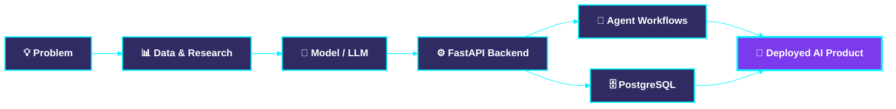

<div align="center">
  
</div>

<div align="center">
  <a href="https://github.com/MirSiam10">
    
  </a>
</div>

<div align="center">
  
  
  
</div>

<br>


<!-- ========================= WHOAMI ========================= -->
<div align="center">
  
</div>

```python
class MirSiam:
    def __init__(self):
        self.role      = "AI Engineer (aspiring) | Recent CSE Graduate"
        self.education = "B.Sc. in CSE, Daffodil International University (2021–2025)"
        self.location  = "Dhaka, Bangladesh 🇧🇩"
        self.focus     = ["Generative AI", "LLM Applications", "Agentic AI", "Backend for AI"]
        self.research  = ["Ensemble Deep Learning", "YOLO-based Detection", "Medical Image Classification"]
        self.stack     = ["Python", "FastAPI", "PostgreSQL", "LLM APIs", "n8n"]
        self.learning  = "Backend + AI: shipping real products, not just notebooks"

    def mission(self):
        return "Build AI systems that are useful, reliable, and a little bit futuristic."

me = MirSiam()
print(me.mission())
```

<!-- ========================= CONTACT ========================= -->
<div align="center">
  
</div>

<div align="center">

| | Platform | Details |
|:--:|:--|:--|
| 📧 | **Email** | [**muir10siam@gmail.com**](mailto:muir10siam@gmail.com) |
| 💼 | **LinkedIn** | [**linkedin.com/in/mirsiam**](https://www.linkedin.com/in/mirsiam/) |
| 📘 | **Facebook** | [**facebook.com/Mir.Siam10**](https://www.facebook.com/Mir.Siam10) |

<a href="mailto:muir10siam@gmail.com">
  
</a>
<a href="https://www.linkedin.com/in/mirsiam/" target="_blank">
  
</a>
<a href="https://www.facebook.com/Mir.Siam10" target="_blank">
  
</a>

</div>


<!-- ========================= TECH ARSENAL ========================= -->
<div align="center">
  
</div>

<div align="center">

### 🤖 &nbsp;**AI / ML**


### 💻 &nbsp;**Languages & Backend**


### 🗄️ &nbsp;**Databases & Tools**


</div>


<!-- ========================= GITHUB ANALYTICS ========================= -->
<div align="center">
  
</div>

<div align="center">
  
  
</div>

<div align="center">
  
</div>

<div align="center">
  
</div>

<div align="center">
  
</div>


<!-- ========================= PROJECTS ========================= -->
<div align="center">
  
</div>

<div align="center">

| 🛰️ Project | 📝 What it does | 🧰 Tech |
|:--|:--|:--|
| **[UnderWaterYOLO](https://github.com/MirSiam10/REPO_NAME)** | **Underwater marine species detection** with YOLO-based computer vision | `YOLO` `Python` `Computer Vision` |
| **[Road Damage Classification](https://github.com/MirSiam10/REPO_NAME)** | **Ensemble deep learning** research for classifying road damage | `Deep Learning` `Ensemble` `Python` |
| **[Leukemia Stage Classifier](https://github.com/MirSiam10/REPO_NAME)** | **4-stage leukemia classification** from medical images | `ResNet18` `VGG16` `Python` |
| **[Jarvis / Alena Voice Assistant](https://github.com/MirSiam10/REPO_NAME)** | A **voice-driven AI assistant** for intelligent automation | `Python` `Voice` `LLM APIs` |

</div>

> 🔧 *Replace each `REPO_NAME` with your real repository name.*


<!-- ========================= ARCHITECTURE ========================= -->
<div align="center">
  
</div>

<div align="center"><b>How I build AI, from idea to deployed product</b></div>




<!-- ========================= FOCUS ========================= -->
<div align="center">
  
</div>

- 🌱 Becoming a strong **AI Engineer**, building **GenAI** and **LLM-powered** applications
- ⚙️ **Backend for AI**: **Python, FastAPI, Pydantic, PostgreSQL**
- 🤖 **Agentic AI** and intelligent **automation workflows**
- 🎙️ Evolving my **voice assistant** project
- 📚 Completed **Grameenphone Academy** programs in **AI workflows, prompt engineering, and workplace automation**


<!-- ========================= SNAKE ========================= -->
<div align="center">
  
</div>

<div align="center">
  
</div>

<!-- ========================= CONNECT ========================= -->
<div align="center">
  
</div>

<div align="center">
  <a href="mailto:muir10siam@gmail.com"></a>
  <a href="https://www.linkedin.com/in/mirsiam/" target="_blank"></a>
  <a href="https://www.facebook.com/Mir.Siam10" target="_blank"></a>
</div>

<br>

<div align="center">
  
</div>

<br>

<div align="center">
  
</div>
