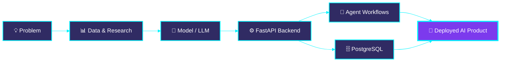

<div align="center">
  <h1 align="center"> Hi <!--<span>-->, I am
  <a href="https://github.com/MirSiam10">
    
  </a>
</div>

<div align="center">
  
</div>

<br>

---

## ⚡ `> whoami`

```python
class MirSiam:
    def __init__(self):
        self.role      = "AI Engineer (aspiring) | Recent CSE Graduate"
        self.education = "B.Sc. in CSE, Daffodil International University (2021–2025)"
        self.location  = "Dhaka, Bangladesh 🇧🇩"
        self.focus     = ["Generative AI", "LLM Applications", "Agentic AI", "Backend for AI"]
        self.research  = ["Ensemble Deep Learning", "YOLO-based Detection", "Medical Image Classification"]
        self.stack     = ["Python", "FastAPI", "PostgreSQL", "LLM APIs", "n8n"]
        self.learning  = "Backend + AI: shipping real products, not just notebooks"

    def mission(self):
        return "Build AI systems that are useful, reliable, and a little bit futuristic."

me = MirSiam()
print(me.mission())
```

---


## 🧠 Tech Arsenal

<div align="center">

**🤖 AI / ML**


**💻 Languages & Backend**


**🗄️ Databases & Tools**


</div>

---

<!-- ===================== GITHUB ANALYTICS (FUTURISTIC) ===================== -->
<div align="center">
  
</div>

<br>

<!-- Row 1: core stats + language donut -->
<div align="center">

  
<!-- </div> <div align="center"> -->
  
</div>


<!-- Row 2: streak -->

<!-- Row 3: profile summary cards -->
<div align="center">
  
  
</div>

<div align="center">
  
  
</div>

<!-- Row 4: trophies -->
<div align="center">
  
</div>

<br>

<!-- Row 5: activity graph -->
<div align="center">
  
</div>

---

## 🚀 Featured Projects

<div align="center">

| 🛰️ Project | 📝 What it does | 🧰 Tech |
|:--|:--|:--|
| **[UnderWaterYOLO](https://github.com/MirSiam10/REPO_NAME)** | Underwater marine species detection with YOLO-based computer vision | `YOLO` `Python` `Computer Vision` |
| **[Road Damage Classification](https://github.com/MirSiam10/REPO_NAME)** | Ensemble deep learning research for classifying road damage | `Deep Learning` `Ensemble` `Python` |
| **[Leukemia Stage Classifier](https://github.com/MirSiam10/REPO_NAME)** | 4-stage leukemia classification from medical images | `ResNet18` `VGG16` `Python` |
| **[Jarvis / Alena Voice Assistant](https://github.com/MirSiam10/REPO_NAME)** | A voice-driven AI assistant for intelligent automation | `Python` `Voice` `LLM APIs` |

</div>

---

## 🔮 System Architecture: How I Build AI



---

## 📡 Currently Focusing On

- 🌱 Becoming a strong **AI Engineer**, building GenAI and LLM-powered applications
- ⚙️ **Backend for AI**: Python, FastAPI, Pydantic, PostgreSQL
- 🤖 **Agentic AI** and intelligent automation workflows
- 🎙️ Evolving my **voice assistant** project
- 📚 Completed Grameenphone Academy programs in AI workflows, prompt engineering, and workplace automation

---


## 🤝 Let's Connect

<div align="center">
  <a href="mailto:muir10siam@gmail.com"></a>
  <a href="https://www.linkedin.com/in/mirsiam/" target="_blank"></a>
  <a href="https://www.facebook.com/Mir.Siam10" target="_blank"></a>
</div>

<br>

<div align="center">
  
</div>

<br>

<div align="center">
  
</div>
